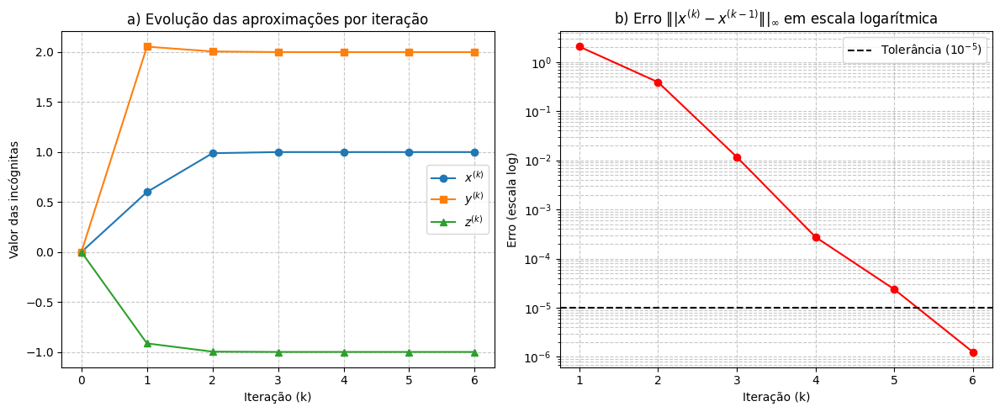
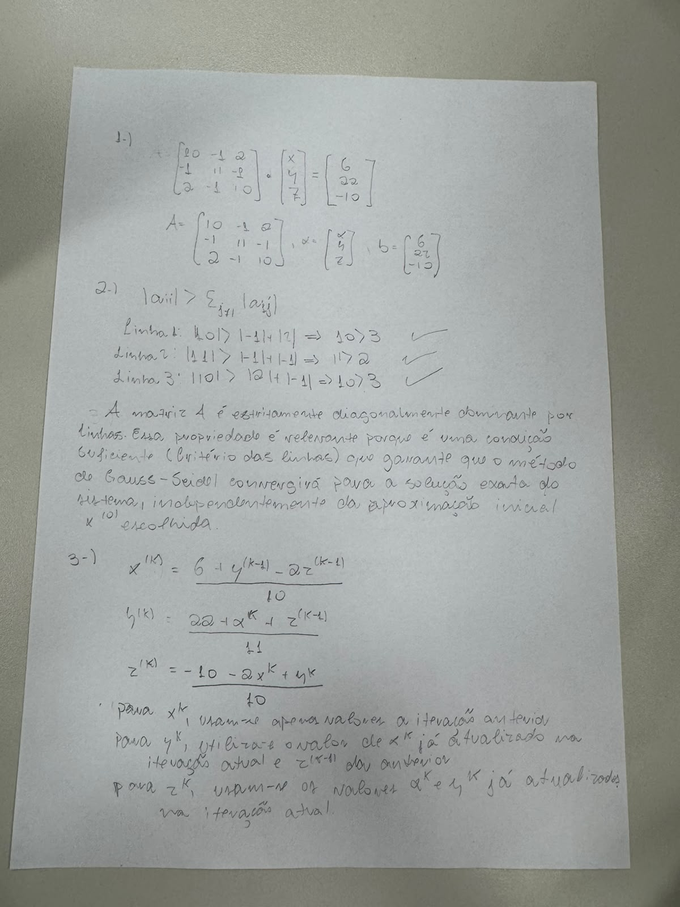
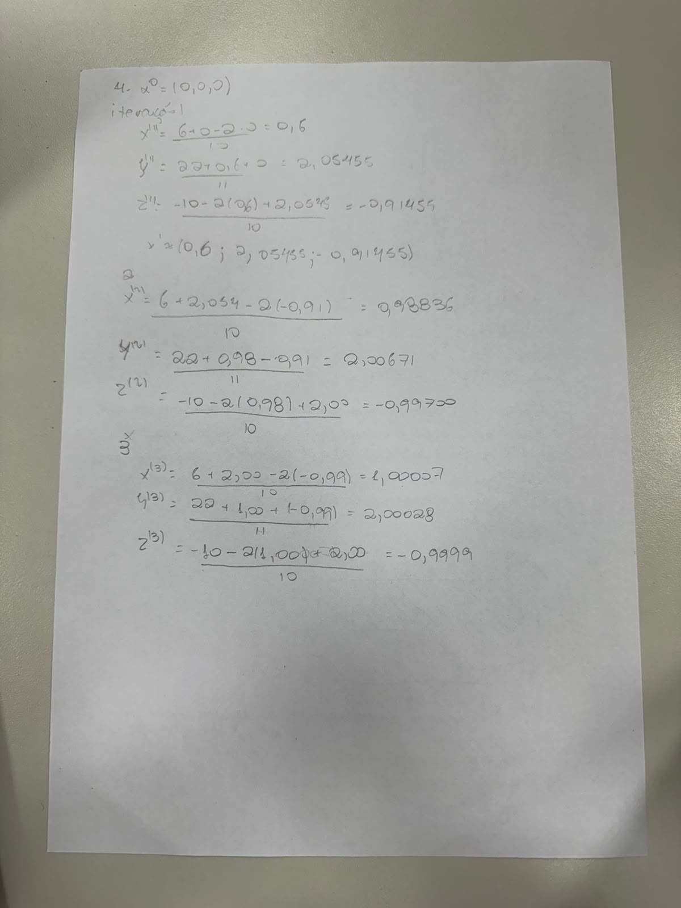

# Atividade Prática — Método de Gauss-Seidel

> **Cálculo Numérico** — UNIFESP SJC  
> **Integrantes:**  
> • Breno Porto Pinheiro do Prado — RA: 185196  
> • Guilherme Bento Ramos — RA: 185226  

---

### 📌 Questão 5 — Convergência e Solução

- **Tolerância ($\epsilon$):** $10^{-5}$
- **Critério de parada:** $\|x^{(k)} - x^{(k-1)}\|_\infty < \epsilon$
- **Número de iterações realizadas:** 6
- **Solução aproximada obtida:**
  - $x \approx 1.00000003$
  - $y \approx 1.99999998$
  - $z \approx -1.00000001$

---

### 📊 Questão 6 — Tabela de Iterações

| $k$ | $x^{(k)}$ | $y^{(k)}$ | $z^{(k)}$ | $\|x^{(k)} - x^{(k-1)}\|_\infty$ |
| :-: | :---: | :---: | :---: | :---: |
| **0** | 0.00000000 | 0.00000000 | 0.00000000 | — |
| **1** | 0.60000000 | 2.05454545 | -0.91454545 | 2.05454545 |
| **2** | 0.98836364 | 2.00671074 | -0.99700165 | 0.38836364 |
| **3** | 1.00007140 | 2.00027907 | -0.99998637 | 0.01170777 |
| **4** | 1.00002518 | 2.00000353 | -1.00000468 | 0.00027554 |
| **5** | 1.00000129 | 1.99999969 | -1.00000029 | 0.00002389 |
| **6** | 1.00000003 | 1.99999998 | -1.00000001 | 0.00000126 |

---

### 📈 Questão 7 — Gráficos de Convergência

---

📝 <b>Resolução Manuscrita (Fotos)</b>

 

  
  

